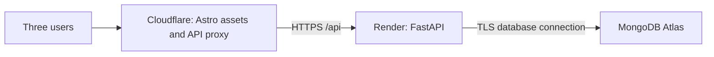

# Cloudflare deployment plan

Hosting guidance checked against official documentation on October 19, 2026. This is an implementation plan; no services have been provisioned or deployed.

## Recommended arrangement

Cloudflare/Wrangler for the frontend is confirmed. Render and MongoDB Atlas are recommended starting points for the remaining services, pending provider/tier selection.

| Component | Proposed home | Responsibility |
| --- | --- | --- |
| Astro static output | Cloudflare Workers Static Assets | HTML, JavaScript, CSS, and profile images |
| Small TypeScript Worker | Cloudflare Workers, deployed alongside assets | Forward `/api` requests to the Python backend |
| FastAPI | One Render web service / one Uvicorn worker | Authentication, authorization, validation, board API |
| MongoDB | MongoDB Atlas | Persistent users, sessions, cards, comments, and counters |



This is a recommendation based on the existing Python/MongoDB design: a conventional Python host lets us use the driver and password-hashing dependencies without adapting them to a different runtime. Render documents a standard [FastAPI deployment](https://render.com/docs/deploy-fastapi). Cloudflare documents [static Astro deployment using Wrangler](https://developers.cloudflare.com/workers/framework-guides/web-apps/astro/).

The browser talks only to the Cloudflare hostname. Atlas is reached by FastAPI, never by browser JavaScript or the proxy Worker. A backend redeployment does not replace database storage.

## Frontend and Wrangler

Keep Astro in static-output mode; the proposed board does not need SSR. Use a separate Worker source file such as `frontend/worker/index.ts` for proxying. Cloudflare's Astro guide explains that static Astro output does not require the SSR adapter. Commit `frontend/wrangler.jsonc` with:

- A project name and explicitly pinned compatibility date.
- `main` pointing to the proxy Worker source.
- `assets.directory` pointing to `./dist`, with an `ASSETS` binding.
- `assets.run_worker_first` covering `/api` and `/api/*`, so API paths always reach the proxy.
- A non-secret `API_ORIGIN` variable containing the backend's HTTPS origin.

All other paths serve Astro assets. Return API errors as API responses, never the frontend HTML fallback. Cloudflare supports selective Worker-first routing in its [asset routing configuration](https://developers.cloudflare.com/workers/static-assets/routing/worker-script/).

Once implemented, the frontend workflow from `frontend/` is:

```powershell
npm ci
npm run build
npx wrangler dev
# After local checks, when deploying:
npx wrangler deploy
```

Install Wrangler as a locked development dependency. Define the build script to produce Astro's `dist/`. Configure the project explicitly before deploying, so automatic framework detection does not replace the intended static-assets-plus-proxy setup. Initial deployment can use a `workers.dev` hostname; a custom domain can follow. Set the actual frontend HTTPS origin in backend configuration.

## Proxy behavior and login cookies

Implement a narrowly scoped proxy to the configured origin, preserving the `/api` prefix and query string. Do not accept an arbitrary destination supplied by the browser.

- Forward method, body, session cookie, original browser Origin, and CSRF header. Preserve response status and all Set-Cookie headers.
- Use host-only Secure/HttpOnly cookies with Path=/; do not set a Domain pointing at the backend provider. The browser receives the cookie from the Cloudflare response.
- Add a shared `PROXY_SECRET` header, replacing any client-supplied value. Validate it in FastAPI before trusting proxy-provided identity/network headers. Store it as a Worker secret and backend secret, never a frontend build variable.
- Replace forwarded client-IP metadata with the address Cloudflare supplies; do not trust user-provided forwarding headers. FastAPI should only use this metadata after proxy authentication, so login throttling distinguishes users correctly.
- Reject direct-origin application requests lacking the proxy secret, including auth routes. Exempt only generic health probes. Sessions and CSRF remain mandatory through the proxy.
- Disable caching for all `/api` responses, including errors and authentication responses. Avoid custom cache rules that override this.
- Use a bounded upstream timeout and return a clear gateway error on failure. Do not automatically retry mutations. Do not automatically follow upstream redirects with sensitive headers; API routes should use canonical paths and return JSON.

Test the complete login/logout flow through Wrangler and the deployed hostname. Keep preview deployments on a separate backend/database or leave their API disabled; production sessions and credentials must not be shared with arbitrary preview origins.

## FastAPI on Render

1. Create one web service from the repository with `backend/` as its root, using either a Python build with the committed lockfile or the project's Dockerfile.
2. Start the app with `uvicorn app.main:app --host 0.0.0.0 --port $PORT --workers 1`. `$PORT` here is the hosting environment variable, not a local PowerShell instruction.
3. Supply `MONGODB_URI`, database name, frontend allowed origin, `PROXY_SECRET`, and initial account credentials through backend secrets. Configure generic health endpoints.
4. Run the idempotent index/account setup in the backend environment before enabling user traffic. Verify that redeploying cannot reset account passwords.
5. Copy the HTTPS service origin into the Worker's `API_ORIGIN` and deploy the frontend/proxy.

The host's [FastAPI guide](https://render.com/docs/deploy-fastapi) covers its build/start configuration. Choose the service tier after reviewing current costs and idle/sleep behavior; this plan does not assume free, always-on hosting. Keep one instance initially because the proposed login limiter is process-local. Revisit throttling before scaling replicas.

## MongoDB Atlas

1. Create an Atlas project and a small cluster appropriate for the data and backup requirements. Place it near the backend region where possible.
2. Create a database user restricted to the application database and obtain the TLS connection URI. Put the URI only in backend secrets.
3. Add the backend service's published outbound IP ranges to Atlas's IP access list. Add an operator's IP temporarily when needed for setup; do not default to allowing all IPs.
4. Verify startup, index creation, a card write/read, and persistence across backend restarts.
5. Configure and test backup restoration before relying on the board for real work.

Render exposes outbound ranges in the service dashboard's Connect / Outbound tab; Atlas uses an IP access list to control database connectivity. See [Render outbound IPs](https://render.com/docs/outbound-ip-addresses) and [Atlas network access](https://www.mongodb.com/docs/atlas/security/ip-access-list/).

Verify backup scheduling, retention, and restore availability for the chosen Atlas tier. If it cannot meet the plan's retention policy, schedule encrypted `mongodump` backups from a trusted runner and test `mongorestore`; pause application writes during a logical backup. Do not equate a managed database with a verified recovery plan. See [Atlas backup and restore](https://www.mongodb.com/docs/atlas/backup-restore-cluster/).

## Options for also hosting FastAPI on Cloudflare

Cloudflare can host FastAPI; the choice needs a little more validation for this project's dependencies.

| Option | What changes | Assessment for this project |
| --- | --- | --- |
| Python Workers | Package the app for Cloudflare's Python runtime and ASGI integration; validate MongoDB connectivity, Argon2id dependencies, lifecycle behavior, and distributed login throttling | Consider only after a small deployed compatibility test; FastAPI support alone does not prove the complete dependency stack works |
| Cloudflare Containers | Package standard Python/Uvicorn in a container and add a Worker/Container controller; validate startup, outbound networking, Atlas allowlisting, secrets, and current service costs | An alternative if keeping application compute on Cloudflare is a priority; retains a normal Python runtime but adds container lifecycle configuration |
| Render web service | Run the planned Python app behind the Cloudflare proxy | Recommended starting point for this three-user project |

Cloudflare documents [FastAPI on Python Workers](https://developers.cloudflare.com/workers/languages/python/packages/fastapi/) and the runtime's [Python package compatibility](https://developers.cloudflare.com/workers/languages/python/packages/). Container deployment is documented separately in [Cloudflare Containers](https://developers.cloudflare.com/containers/).

For either Cloudflare backend option, keep MongoDB on Atlas. Cloudflare Container disks are ephemeral by default, so simply putting `mongod` in a container does not provide the required durable database. See [Container lifecycle and storage](https://developers.cloudflare.com/containers/concepts/architecture/). Using a different Cloudflare database would require revising the MongoDB requirement and data implementation; it is outside the current plan.

## Deployment completion checks

- Wrangler deploys assets and proxy together; all five board columns load from the production API.
- Login, session restoration, logout, CSRF protection, and author-only comment editing/deletion work through Cloudflare.
- Two users attempting the same card update still receive correct conflict behavior through the proxy.
- API responses are never cached, direct backend access is rejected, and credentials are absent from generated assets and logs.
- Restarting/redeploying the backend preserves data, and a backup restores successfully into an isolated database.
