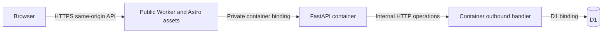

# MongoDB to Cloudflare D1 migration plan

Updated October 21, 2026. **Status: planned, not implemented or deployed.** The user requested this plan and updates to the repository's planning documents. The current executable code still uses MongoDB. This plan supersedes Atlas provisioning, Atlas network access and fixed-egress gateway work as the proposed deployment path; it does not authorize remote changes.

## Outcome and constraints

Use Cloudflare D1 for all persistent kanban state while preserving Astro, FastAPI, the public API and existing password/session security. Production is fresh: there is no production MongoDB dataset to import. Keep existing local MongoDB data and historical test results intact. Production usernames remain `sea`, `poopfart`, `sneaky`; do not copy local fixture accounts or credentials.

Keep the confirmed account `f7011f208b78981f9835cabb9f4c24c1`, Worker `kanban-sneakybeak-net`, and hostname `kanban.sneakybeak.net`. Use a new D1 database proposed as `kanban-prod`, with separate disposable development/test databases. Database IDs are assigned only when the corresponding creation is authorized; do not invent IDs.

The user wants no additional D1 cost beyond the existing $5/month Workers plan. Design and measure against the included D1 allowances; no paid gateway, Atlas upgrade or additional database subscription is proposed. Included usage is not an enforced billing cap. Resolve any strict zero-overage requirement before remote use; neither this plan nor budget alerts guarantee a $5 total bill. Existing Container/Worker charges remain separate considerations.

Preserve Argon2id, HS256 JWTs in host-only Secure/HttpOnly/SameSite=Lax cookies, server-side token revocation, exact Origin validation, ingress authentication, persistent throttling, all validation/error codes and CRUD revision contracts. No GitHub SSO, public signup, new frontend design, automatic account seeding or automatic mutation replay. WSL/sidecar repair remains deferred and is not an acceptance prerequisite.

## Proposed architecture

Retain Python authentication/business validation in FastAPI. Put SQL and atomic database operations in a small TypeScript adapter under `frontend/worker/`. FastAPI calls typed repository methods over an internal HTTP client instead of calling PyMongo collections. This adds an internal service boundary, not a second publicly routed service. A full backend rewrite into JavaScript or Python Workers is outside this migration.

Cloudflare documents that Container outbound handlers can access Worker bindings and intercept a synthetic hostname. The installed `@cloudflare/containers` 0.3.7 exposes `ContainerProxy`, `outboundByHost`, and handler context containing the container ID/class. Proposed wiring: export `ContainerProxy`, intercept only `http://kanban-db.internal`, and execute fixed operations through `env.DB`. Set `enableInternet=false`; reject unexpected destinations, ports, methods and paths instead of forwarding them to the Internet. Avoid an `allowedHosts` fallback that unintentionally permits Internet access. This synthetic hostname needs no public DNS record. [Outbound handler documentation](https://developers.cloudflare.com/containers/configuration/outbound-traffic/).

The hostname is not an authentication secret. Restrict use to the expected Container class/instance through trusted handler context, and validate operation envelopes and bounded payloads. The public Worker `fetch` entrypoint must never dispatch database operations or trust browser-supplied internal headers. Test that forged Host/path/proxy headers cannot reach the adapter. Fail closed when interception or the D1 binding is missing. Do not give the container a Cloudflare account API token or use the public D1 management API for application traffic.

Keep `JWT_SECRET` and `PROXY_SECRET` in runtime secrets. Replace `MONGO_URL`/`MONGO_DB` configuration with a D1 binding and internal adapter configuration only after the new path passes. Never pass a D1 binding object as a container environment variable or treat D1 as a file mounted inside the container. Preserve the 20-second outer proxy deadline and 25-second browser timeout; adapter deadlines must fit inside the request's remaining budget. Use persistent HTTP connections and whole-operation calls, not one HTTP request per SQL statement.

**First milestone:** prove container -> outbound handler -> D1 communication, private-only reachability, denial of other egress, and readiness without recursion/deadlock. Current APIs support this design in documentation; this repository has not demonstrated it. Use local Worker/D1 tests without Containers where possible, followed by an authorized isolated hosted probe for the actual container network. Do not substitute an unprotected public SQL endpoint if that probe fails.

## Persistence interface and schema

Introduce explicit Python repositories for users, sessions, login allowances and board operations. Keep routes and Pydantic request/response schemas stable. Operations are versioned, allowlisted names with validated parameters; arbitrary SQL, arbitrary table names and arbitrary upstream URLs are not accepted from FastAPI or the browser. Parameterize all SQL values. Version the adapter contract independently of database migration numbers so mixed Worker/container rollout can fail safely.

Proposed tables (final DDL belongs in numbered migrations):

| Table | Data and constraints | Important indexes |
| --- | --- | --- |
| `users` | Canonical `username` text primary key; Argon2id `password_hash`; no public hash exposure | Primary key |
| `tokens` | `jti` primary key, username foreign key, expiry as UTC epoch milliseconds; never the raw JWT | Username and expiry |
| `login_limits` | Bucket key, count, expiry; one global key plus hashed canonical username keys | Primary key and expiry |
| `cards` | Existing opaque ID, unique ticket number, title/description/tag, column/position, difficulty/health, creator, timestamps, content version, discussion version | Unique ticket number; `(column, position, id)` |
| `card_assignees` | Card/user foreign keys; unique `(card_id, username)`; ordinal preserves submitted list order; at most three | Card and ordinal |
| `comments` | Existing opaque ID, card/user foreign keys, text, timestamps, independent revision, ordinal preserves discussion order | `(card_id, ordinal, id)` |
| `counters` | `tickets` key with monotonically increasing integer value | Primary key |
| `column_orders` | One row per current column with revision initially zero | Primary key |

Use foreign keys and CHECK constraints for structural invariants, backed by the existing Pydantic validation. Cascade assignee/comment removal on a guarded card deletion; do not introduce cascading user deletion. Preserve the five-column order `review`, `backlog`, `in_progress`, `done`, `blocked`; SQL alphabetical ordering is incorrect. Serialize timestamps in the existing UTC API format, preserving millisecond precision and safe integer revision/ticket handling. Return the same nested card/comment/assignee payloads even though storage is normalized.

Use versioned SQL migrations, including initial counters/column rows and indexes, applied deliberately by the operator. Runtime startup verifies the expected schema/protocol version and performs a cheap D1 round trip; it must not apply DDL or seed accounts. D1 foreign keys are enforced; migration ordering and cascades must be tested using D1 tooling. [Migrations](https://developers.cloudflare.com/d1/reference/migrations/), [foreign keys](https://developers.cloudflare.com/d1/sql-api/foreign-keys/).

## Atomicity and consistency: implementation gate

D1 `batch()` provides transactional execution with rollback on a failing statement. It is not an interactive MongoDB transaction callback: do not spread `BEGIN`, reads, Python decisions, writes and `COMMIT` across HTTP requests. A conditional UPDATE affecting zero rows is not a SQL failure and does not automatically roll back earlier statements. [D1 batch API](https://developers.cloudflare.com/d1/worker-api/d1-database/).

Each logical mutation must be one server-controlled batch or one atomic statement. Preconditions must run inside that transaction and force rollback if violated. Proposed proof: a small transaction-local-in-effect guard table with a request/stage primary key and `CHECK(ok=1)`. Insert a guard whose `ok` is computed from current database state; a false predicate causes a constraint error. Successful batches delete their own guards before commit; failed batches roll them back. This is an implementation aid, not a durable operation log or idempotency promise. Verify it on actual D1 semantics before adopting it; a tested trigger-based alternative is acceptable. Map fixed guard stages to existing domain errors without leaking SQL, values, hashes or driver messages.

Preserve the current precedence of missing resource, stale content, missing/stale order revisions, anchor validity and author checks. Avoid diagnosing errors through an unprotected follow-up read that can race with another writer. Return the mutation result and order revisions from the same batch. Treat unknown failures/timeouts as uncertain; never retry a mutation automatically. A database error must not leave partial reordering, counter reset, revision bumps or orphaned comments.

Operation design and proof obligations:

| Operation | Required behavior |
| --- | --- |
| Board read | One read-only batch/snapshot for cards, assignees, comments and order revisions; bounded number of queries, no per-card round trips; return complete board |
| Ticket allocation/create | Allocate ticket once via atomic counter increment, separately from card-create transaction as today; gaps after failed creation are allowed and values never decrement/reuse. Create transaction validates assignees, appends position, inserts card/assignees and advances column revision |
| Card patch | Validate existing card and expected content version inside the batch, including Blocked health and assignees; update only supplied fields; increment content version once; preserve discussion version |
| Card move | Check expected card version and source/destination order revisions before anchor validity; compute ordering from SQL state inside the batch; set-based renumbering changes only affected positions, not neighbors' content versions/timestamps; bump distinct affected columns once; preserve source gaps and Blocked rules |
| Card delete | Check both content and discussion revisions; remove card/dependents and bump its column revision atomically |
| Add comment | Check card existence and fewer than 20 comments inside the transaction, append ordinal, increment discussion version only; concurrent twentieth/twenty-first additions cannot both succeed |
| Edit/delete comment | Check card/comment existence, author before stale-version rejection, and comment version; apply change and bump discussion version atomically; preserve card content version/timestamp |

For the first release, use primary-only D1 access without read replication/Sessions routing. This avoids stale authentication/revocation checks and simplifies full-board snapshots; a D1 session/bookmark is not itself a multi-query transaction. Any later replication change must re-prove read-after-write and logout revocation. [D1 read consistency](https://developers.cloudflare.com/d1/best-practices/read-replication/).

## Authentication, throttling and account tools

Keep the existing Python Argon2id hasher, unknown-user dummy verification, JWT claim checks and cookie behavior. Replace collection dependencies in `auth.py` and auth/user routes with repositories. Query tokens joined to users for exact ownership and unexpired records; logout deletes the matching JTI and replay must immediately fail. Password reset remains an explicit operator operation and atomically updates the hash plus deletes that user's session rows. Ordinary provisioning is insert-only and refuses duplicates, including races.

Port login reservations as atomic SQL UPSERT/RETURNING operations using the database's clock. Preserve five attempts per canonical username per 15 minutes, 30 shared per five minutes, non-extending cooldowns and positive `Retry-After`. Reserve global first; if it rejects, create no username bucket. Retain a successful global reservation when the username bucket or credentials reject. Do not wrap both reservations in a transaction that rolls global consumption back on username rejection. Database failure remains a generic 503 before password work; do not use process-local counters or cache authentication decisions.

D1 does not provide MongoDB TTL indexes. Enforce expiry in every token/allowance query, independently of physical cleanup. Add indexed, bounded cleanup for expired token and username-limit rows, initially at most 1,000 rows per table per scheduled daily run, with no unbounded catch-up loop or reset of live buckets. Measure this budget and adjust if necessary. The scheduled Worker operation must not wake the FastAPI container merely to clean rows. No destructive cleanup of unrelated records.

Replace the Mongo-only operator commands for the D1 target. Hash passwords locally using hidden input, select exact account/database IDs, insert through an operator-only path with no production signup endpoint, and verify sanitized account existence. Avoid password/hash literals in command arguments, source, console output or committed SQL. If temporary protected files are used for tooling, restrict access, suppress result payloads and remove them afterward. Preserve a separate explicit reset mode with revocation; never implement provisioning as an upsert. Existing Mongo commands remain clearly labeled until D1 provisioning is verified, then remove obsolete production references.

## Cost design and acceptance

As checked October 21, Workers Paid includes **25 billion rows read/month, 50 million rows written/month, and 5 GB D1 storage** across the account. Above these, prices are $0.001/million reads, $1/million writes, and $0.75/GB-month. No separate D1 subscription or data-egress charge is required. Index maintenance contributes to writes and scans count as reads even if few rows are returned. [D1 pricing](https://developers.cloudflare.com/d1/platform/pricing/).

Budget target is **$0 incremental D1 usage charges**, not an assertion that all Cloudflare services stay at $5. Inspect existing account D1 usage before allocation. Keep indexed token/bucket/user lookups, bounded SQL statement counts and set-based order updates. Retain visible-only, non-overlapping 15-second polling; do not add constant heartbeat probes or write on every board read. Set request/body/query deadlines and limits without changing the complete-board contract. The existing full-board API can grow in cost with board size; measure that explicitly rather than assuming requests equal rows.

Capture only aggregate operation counts, latency, `rows_read`, `rows_written` and storage size in cost telemetry; no SQL parameters, content, credentials or hashes. Include successful/failed writes, guard/index overhead, login abuse and cleanup. Model a busy month plus margin from measured costs. Example assumption, not a measurement: three users polling continuously every 15 seconds for 30 days produce 518,400 board requests. At 1,000 rows scanned per board operation that is 518.4 million rows read (about 2.1% of included reads), before session lookups and other operations. Measure actual normalized-table reads and container costs separately.

Review billing alerts and define conservative application usage thresholds before release. Alerts are informational, not enforcement; app throttles and monitoring reduce risk but do not guarantee an account-level hard cap. The paid plan bills overages. If the user's requirement means absolutely no possible additional charge, stop before remote use until a verified enforceable billing arrangement is agreed. Do not claim alerts satisfy it. [Budget alerts](https://developers.cloudflare.com/billing/manage/budget-alerts/).

## Ordered implementation milestones

1. **Freeze contracts and prove the risky pieces.** Inventory API fixtures and error precedence from `06-backend-crud.md`, `07-auth-follow-up.md` and current tests. Prove D1 batch rollback on false guards, read snapshot consistency, concurrent ordering/comment limits, and atomic throttle reservations in local Wrangler D1. Prepare an isolated hosted outbound-handler probe; execute it only with approval. Passing these proofs selects the internal adapter design before wholesale persistence replacement.
2. **Add schema and repositories.** Create numbered migrations under `frontend/migrations/`, TypeScript operation types/SQL under `frontend/worker/`, and a Python internal-client/repository layer under `backend/app/`. Add schema/protocol checks and safe database-unavailable mapping. Do not emulate arbitrary Mongo collection APIs or maintain permanent dual writes.
3. **Port auth and operator workflows.** Move user/session/limiter access first; prove exact cookies, logout replay, reset revocation, primary reads, expiry and shared concurrency limits. Add insert-only D1 provisioning and bounded expiry cleanup.
4. **Port board persistence.** Implement the atomic operations above, nested response assembly, timestamp/ordinal preservation, and domain error mapping. Keep frontend payloads, IDs, revision semantics and retry UX unchanged.
5. **Integrate runtime/configuration.** Add the D1 binding, outbound adapter and restricted egress. Replace runtime Mongo configuration; retain stable JWT/ingress secrets. Change readiness to validate the adapter/D1/schema, with liveness process-only. Update `errors.py`, `main.py`, routes, Docker packaging, worker/proxy types and environment examples. Remove PyMongo and its lockfile dependency only once all runtime references are gone. Keep Argon2 and authentication dependency versions unchanged unless a verified compatibility issue requires a scoped change.
6. **Adapt checks and operator docs.** Replace disposable replica-set integration fixtures with isolated local D1 databases behind the real adapter. Run actual FastAPI against those repositories and the unchanged browser contract. Develop a loopback-only test bridge for Python-to-local-Worker testing without needing the broken Container sidecar; it must be excluded from production entrypoints/config. Keep the real hosted outbound path as a separate acceptance gate. Rewrite production instructions to D1 before releasing; archive historical Mongo/WSL evidence clearly.
7. **Prepare and approve release.** Present the reviewed diff, local test results, usage projection, exact account/database names, secret handling, migration SQL and isolated/production write budgets. After authorization create the target D1 resources, apply migrations, provision `sea`, `poopfart`, `sneaky` once, deploy and execute hosted acceptance. No Atlas network changes, gateway purchases, cluster deletion or account reset are needed.
8. **Record and commit results.** Capture deployment/image IDs, schema/protocol versions, database IDs, costs and acceptance/cleanup results. Commit coordinated code/documentation locally; do not claim migration complete until hosted persistence and recovery have been demonstrated.

## Verification and hosted acceptance

Use the existing API tests as the behavioral baseline, adapting infrastructure-specific fixtures rather than weakening assertions. Add real D1 integration cases for:

- Transaction failure after intermediate statements: no partial content, discussion, assignment or ordering changes; no surviving guard rows.
- Racing moves, stale anchors, same-column moves, dual order-version checks, failed create gaps, concurrent comment-cap enforcement, guarded deletion and author/error precedence.
- Independent processes racing login reservations, expiry boundaries, global-before-username consumption, rejected Origin causing no storage work, and database failures preventing credential verification.
- Session restoration, no-Origin GET `/me`, logout/replay, password reset revocation, missing user/token, expired rows before cleanup and opaque error logging.
- D1 missing binding/schema, adapter protocol mismatch, denied synthetic-host access from public routes, forged headers, internal timeout, malformed response and committed-but-lost mutation response without replay.
- JSON contract parity for full-board responses, assignee/comment ordering, timestamp precision and independent revision merging in existing browser journeys.

Run backend lint/format/contract/integration checks; Worker/D1 operation tests; Astro/TypeScript checks, frontend build and focused browser journeys; Windows Docker build and deployment dry-run after runtime changes. A generic SQLite unit test is useful but cannot replace D1 integration tests. Do not repeat historical Mongo acceptance merely to claim D1 coverage or require WSL repair.

Hosted acceptance retains the earlier budget of at most three marked cards and four comments total, exact-ID cleanup, permanent ticket/order increments, two-account collaboration and third-account login. Verify actual public HTTPS, JSON API errors, no-store, Origin/ingress configuration, secure cookies, throttling, concurrency, and persistence of records/sessions/allowances through actual container sleep/wake and replacement. Add proof that all state remains in the selected D1 database, Mongo credentials are absent, external container egress is denied and public adapter access is impossible. Direct private-ingress rejection remains explicitly unverified unless a suitable approved diagnostic path exists; do not expose one publicly.

The isolated hosted connection proof needs a separately named disposable D1 database and Worker with a bounded test table/row budget; record exact IDs and obtain approval for its creation/deletion. Never test the proof against production data or leave a public diagnostic database route.

## Data transition, recovery and rollout

Start production with an empty D1 schema and explicitly created accounts. Do not import local `kanban_dev`, fixture users, sessions, allowances or old Atlas test databases. If existing production data is discovered, stop and add an explicit export/transform/validation plan before proceeding; no reset is implied.

Use backward-compatible schema/adapter changes during Worker/container rollout. An old Mongo image cannot simply run against D1. Stage compatibility changes and verify the deployed image; abort mixed protocol/schema versions safely. Since production has never launched, there is no proven prior production release to restore. Preserve source and image identities, and stop traffic on an incompatible initial release rather than inventing a Mongo fallback.

D1 Paid currently includes 30-day Time Travel. Record a pre-migration recovery bookmark and validate a restore using disposable data before relying on it. Do not restore production just to test recovery. Restore may resurrect revoked sessions: revoke restored tokens or rotate the signing secret before serving restored data. Maintain an access-restricted export when needed; never commit one containing account hashes or user content. [Time Travel](https://developers.cloudflare.com/d1/reference/time-travel/).

Once users have written to D1, reverting code to Mongo would hide their new data. Prefer compatible forward fixes or an explicitly authorized D1 restore with understood data-loss boundaries. No dual-write system or automatic cross-database rollback is planned. Local Mongo resources and Atlas remain untouched unless separately authorized for cleanup.

## File scope and documentation status

Expected implementation files: `backend/app/{main,config,auth,ratelimit,cards_store,errors}.py`, feature routes and operator tools; new repository/client modules; backend dependency/lock files and tests; `frontend/worker/{index,proxy}.ts`, new D1 operations/migrations/tests, both Wrangler configs and environment examples. Adjust existing Docker/test harnesses only where the new persistence/transport requires it. Public API schemas and frontend UI should not need behavioral changes.

Update `.agent/README.md`, `next-steps.md`, backend/data, delivery, deployment and authentication plans, plus root/backend/frontend READMEs. Retain old evidence as historical Mongo evidence and label unfinished D1 work honestly. Mongo deployment commands remain documentation of current code until replaced; they are not the active release instructions.

This planning pass changed Markdown only. No D1 resources, accounts, secrets, migrations, code changes, deployments or remote deletions were performed. Checks for this pass are documentation consistency, relative links and `git diff --check`; implementation suites belong to the milestones above.
