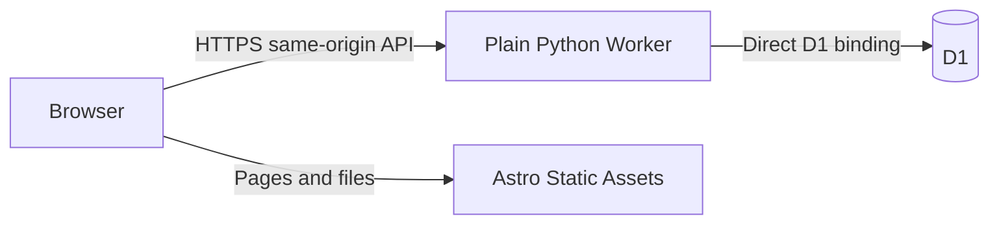

# Plain Python Workers + D1 migration plan

Updated October 22, 2026. **Status: documentation only; not implemented or deployed.** The active target is a plain Python Worker with direct D1 access. This supersedes FastAPI/Containers, the private TypeScript D1 adapter, Atlas networking work, and a TypeScript API rewrite. The current executable code still uses FastAPI/MongoDB. The user requested plans only; implementation and deployment are separate future work.

## Outcome and constraints

Use Cloudflare D1 for all persistent kanban state and a plain Python Worker for the API. Keep Astro/browser TypeScript, reusable Python business logic, the public API and existing password/session security. Replace FastAPI routing, ASGI/Uvicorn and Containers with direct Worker handlers. Production was last recorded as fresh; verify that before provisioning. Keep local MongoDB data and historical test results intact. Production usernames remain `sea`, `poopfart`, `sneaky`; do not copy local fixture accounts or credentials.

Keep the confirmed account `f7011f208b78981f9835cabb9f4c24c1`, Worker `kanban-sneakybeak-net`, and hostname `kanban.sneakybeak.net`. Use a new D1 database proposed as `kanban-prod`, with separate disposable development/test databases. Database IDs are assigned only when the corresponding creation is authorized; do not invent IDs.

Use the already purchased **$5/month Workers Paid plan now** and target its included allowances. D1 needs no container or separate database subscription. Consider Free next month only after measuring CPU, requests, rows and storage; it is optional follow-up, not a deployment gate. Do not weaken password security to fit Free. Included usage is not a hard spending cap. No billing changes are part of this documentation pass.

Preserve Argon2id, HS256 JWTs in host-only Secure/HttpOnly/SameSite=Lax cookies, server-side token revocation, exact Origin validation, persistent throttling, all validation/error codes and CRUD revision contracts. The container shared-secret boundary disappears with the container; browser authentication and Origin protection remain. No GitHub SSO, public signup, frontend redesign, automatic account seeding or mutation replay. WSL/Container-sidecar repair is not an acceptance prerequisite.

## Proposed architecture

Use one Python `WorkerEntrypoint` with `fetch` and a small method/path dispatcher, with separate Python auth, validation, service and repository modules. Call D1 directly through `self.env.DB`; do not add a TypeScript SQL adapter, public SQL endpoint or runtime account API token. [Python handlers](https://developers.cloudflare.com/workers/languages/python/basics/), [Python D1 example](https://developers.cloudflare.com/d1/examples/query-d1-from-python-workers/).

Attach the Astro static build to the same Worker deployment. Preserve the hostname, disabled workers.dev/preview URLs, HTML/404 behavior, and Worker-first handling of `/api` and `/api/*`; API failures never fall through to HTML. Prefer the existing canonical Wrangler config pointing at the Python entrypoint and `frontend/dist`. Verify packaging early; if Python tooling requires moving that config beside the backend, update script paths and keep one deployment. [Static Assets](https://developers.cloudflare.com/workers/static-assets/).

Enforce canonical host and exact trusted Origin for unsafe requests before body parsing, authentication work or database access. Reject missing/null/duplicate/malformed/untrusted Origin without repairing it from Referer or forwarding headers. Preserve authenticated access and author checks independently; never trust caller-supplied proxy headers. Keep API responses `no-store`.

Keep `JWT_SECRET` stable in runtime secrets. Replace Mongo settings with a D1 binding and read configuration through Worker environment bindings. Retire `PROXY_SECRET`, active Container/DO bindings and image build steps after replacement verification. Inspect any deployed Durable Object migration history before removal; do not blindly rewrite applied migrations or delete deployed state. Keep the 25-second browser timeout, bounded payloads and a server deadline inside it; the old 20-second container proxy disappears. A timeout does not prove rollback, and mutations are never automatically replayed.

## First milestone: prove the Python runtime

Before porting the full API, prove a plain handler, compatible validation/serialization dependencies, Argon2 correct/wrong/dummy verification, JWT/cookies, a bound D1 query and batch rollback, and Astro assets in the same deployment. Measure initial/repeated/concurrent request CPU, wall time and memory. This proof is future implementation work, not a completed result.

Use Cloudflare's `pywrangler`/`uv` workflow, the `python_workers` compatibility flag and pinned SDK/dependency versions. CPython install success does not prove Pyodide compatibility. Reuse Pydantic, PyJWT and Argon2 packages where supported; do not implement cryptography from scratch. [Python tooling](https://developers.cloudflare.com/workers/languages/python/), [packages](https://developers.cloudflare.com/workers/languages/python/packages/).

The current `asyncio.to_thread` password verification cannot carry over unchanged: Python Workers do not support functional threads. Argon2-cffi documents WebAssembly parallelism of one. Test actual existing encoded hashes before claiming compatibility; changing encoded parameters does not convert a hash. For fresh hosted accounts, select a secure, tested runtime-compatible profile before provisioning. Never silently reset accounts or weaken hashing for Free. [Standard library](https://developers.cloudflare.com/workers/languages/python/stdlib/), [Argon2 support](https://argon2-cffi.readthedocs.io/en/stable/api.html#argon2.exceptions.UnsupportedParametersError).

Python imports can execute during deployment snapshotting. Replace import-time dummy-hash generation with a compatible design, such as a precomputed nonsecret dummy hash using the selected profile. Generate real salts, tokens and random IDs at appropriate runtime/operator boundaries. Keep secrets out of snapshots. [Python lifecycle](https://developers.cloudflare.com/workers/languages/python/how-python-workers-work/).

Python is the selected direction. Report concrete failing evidence if this proof reveals a blocker; do not reopen the language decision speculatively.

## HTTP boundary and reusable Python code

Replace FastAPI routing, dependencies, middleware, lifespan initialization and response/cookie helpers with direct Worker handlers. Reuse compatible Pydantic models and business rules. Preserve routes/methods, statuses, error codes/field locations, strict revision integers, omitted-versus-null behavior, extra-field rejection, normalization and timestamps. Test request-validation order and unknown-route/method behavior rather than assuming framework-free handlers match automatically.

Liveness checks the handler; readiness performs a cheap D1/schema check with sanitized failures. No request/startup path applies DDL or seeds accounts. Keep the existing API assertions from `06-backend-crud.md` and security contract from `07-auth-follow-up.md`.

## Persistence interface and schema

Introduce explicit Python repositories for users, sessions, login allowances and board operations calling bound D1 prepared statements. Keep public routes and request/response schemas stable. SQL and table names are server-controlled; parameterize values. Put numbered migrations under `backend/migrations/` and reference them from the canonical Wrangler config. Track schema compatibility without an internal HTTP adapter protocol.

Proposed tables (final DDL belongs in numbered migrations):

| Table | Data and constraints | Important indexes |
| --- | --- | --- |
| `users` | Canonical `username` text primary key; Argon2id `password_hash`; no public hash exposure | Primary key |
| `tokens` | `jti` primary key, username foreign key, expiry as UTC epoch milliseconds; never the raw JWT | Username and expiry |
| `login_limits` | Bucket key, count, expiry; one global key plus hashed canonical username keys | Primary key and expiry |
| `cards` | Existing opaque ID, unique ticket number, title/description/tag, column/position, difficulty/health, creator, timestamps, content version, discussion version | Unique ticket number; `(column, position, id)` |
| `card_assignees` | Card/user foreign keys; unique `(card_id, username)`; ordinal preserves submitted list order; at most three | Card and ordinal |
| `comments` | Existing opaque ID, card/user foreign keys, text, timestamps, independent revision, ordinal preserves discussion order | `(card_id, ordinal, id)` |
| `counters` | `tickets` key with monotonically increasing integer value | Primary key |
| `column_orders` | One row per current column with revision initially zero | Primary key |

Use foreign keys and CHECK constraints for structural invariants, backed by the existing Pydantic validation. Cascade assignee/comment removal on a guarded card deletion; do not introduce cascading user deletion. Preserve the five-column order `review`, `backlog`, `in_progress`, `done`, `blocked`; SQL alphabetical ordering is incorrect. Serialize timestamps in the existing UTC API format, preserving millisecond precision and safe integer revision/ticket handling. Return the same nested card/comment/assignee payloads even though storage is normalized.

Use versioned SQL migrations, including initial counters/column rows and indexes, applied deliberately by the operator. Readiness verifies the expected schema version and performs a cheap D1 round trip; it must not apply DDL or seed accounts. D1 foreign keys are enforced; migration ordering and cascades must be tested using D1 tooling. [Migrations](https://developers.cloudflare.com/d1/reference/migrations/), [foreign keys](https://developers.cloudflare.com/d1/sql-api/foreign-keys/).

## Atomicity and consistency: implementation gate

D1 `batch()` provides transactional execution with rollback on a failing statement. It is not an interactive MongoDB transaction callback: do not spread `BEGIN`, reads, Python decisions, writes and `COMMIT` across HTTP requests. A conditional UPDATE affecting zero rows is not a SQL failure and does not automatically roll back earlier statements. [D1 batch API](https://developers.cloudflare.com/d1/worker-api/d1-database/).

Each logical mutation must be one server-controlled batch or one atomic statement. Preconditions must run inside that transaction and force rollback if violated. Proposed proof: a small transaction-local-in-effect guard table with a request/stage primary key and `CHECK(ok=1)`. Insert a guard whose `ok` is computed from current database state; a false predicate causes a constraint error. Successful batches delete their own guards before commit; failed batches roll them back. This is an implementation aid, not a durable operation log or idempotency promise. Verify it on actual D1 semantics before adopting it; a tested trigger-based alternative is acceptable. Map fixed guard stages to existing domain errors without leaking SQL, values, hashes or driver messages.

Preserve the current precedence of missing resource, stale content, missing/stale order revisions, anchor validity and author checks. Avoid diagnosing errors through an unprotected follow-up read that can race with another writer. Return the mutation result and order revisions from the same batch. Treat unknown failures/timeouts as uncertain; never retry a mutation automatically. A database error must not leave partial reordering, counter reset, revision bumps or orphaned comments.

Operation design and proof obligations:

| Operation | Required behavior |
| --- | --- |
| Board read | One read-only batch/snapshot for cards, assignees, comments and order revisions; bounded number of queries, no per-card round trips; return complete board |
| Ticket allocation/create | Allocate ticket once via atomic counter increment, separately from card-create transaction as today; gaps after failed creation are allowed and values never decrement/reuse. Create transaction validates assignees, appends position, inserts card/assignees and advances column revision |
| Card patch | Validate existing card and expected content version inside the batch, including Blocked health and assignees; update only supplied fields; increment content version once; preserve discussion version |
| Card move | Check expected card version and source/destination order revisions before anchor validity; compute ordering from SQL state inside the batch; set-based renumbering changes only affected positions, not neighbors' content versions/timestamps; bump distinct affected columns once; preserve source gaps and Blocked rules |
| Card delete | Check both content and discussion revisions; remove card/dependents and bump its column revision atomically |
| Add comment | Check card existence and fewer than 20 comments inside the transaction, append ordinal, increment discussion version only; concurrent twentieth/twenty-first additions cannot both succeed |
| Edit/delete comment | Check card/comment existence, author before stale-version rejection, and comment version; apply change and bump discussion version atomically; preserve card content version/timestamp |

For the first release, use primary-only D1 access without read replication/Sessions routing. This avoids stale authentication/revocation checks and simplifies full-board snapshots; a D1 session/bookmark is not itself a multi-query transaction. Any later replication change must re-prove read-after-write and logout revocation. [D1 read consistency](https://developers.cloudflare.com/d1/best-practices/read-replication/).

## Authentication, throttling and account tools

Keep Argon2id through the runtime proof above, unknown-user dummy verification, HS256 JWT claim checks, seven-day sessions and existing cookie behavior. Replace collection dependencies in `auth.py` and auth/user handlers with repositories. Query tokens joined to users for exact ownership and unexpired records; logout deletes the matching JTI and replay must immediately fail. Password reset explicitly and atomically updates the hash plus deletes that user's sessions. Ordinary provisioning is insert-only and refuses duplicates, including races.

Port login reservations as atomic SQL UPSERT/RETURNING operations using the database's clock. Preserve five attempts per canonical username per 15 minutes, 30 shared per five minutes, non-extending cooldowns and positive `Retry-After`. Reserve global first; if it rejects, create no username bucket. Retain a successful global reservation when the username bucket or credentials reject. Do not wrap both reservations in a transaction that rolls global consumption back on username rejection. Database failure remains a generic 503 before password work; do not use process-local counters or cache authentication decisions.

D1 does not provide MongoDB TTL indexes. Enforce expiry in every token/allowance query, independently of physical cleanup. Add indexed, bounded cleanup for expired token and username-limit rows, initially at most 1,000 rows per table per scheduled daily run, with no unbounded catch-up loop or reset of live buckets. Use the Python Worker's scheduled handler; no public maintenance endpoint. Measure this budget and adjust if necessary. No destructive cleanup of unrelated records.

Replace the Mongo-only operator commands for the D1 target. Hash passwords locally using hidden input, select exact account/database IDs, insert through an operator-only path with no production signup endpoint, and verify sanitized account existence. Avoid password/hash literals in command arguments, source, console output or committed SQL. If temporary protected files are used for tooling, restrict access, suppress result payloads and remove them afterward. Preserve a separate explicit reset mode with revocation; never implement provisioning as an upsert. Existing Mongo commands remain clearly labeled until D1 provisioning is verified, then remove obsolete production references.

## Cost design and acceptance

Workers Paid's $5 monthly minimum includes 10 million requests and 30 million CPU milliseconds, with usage-based overages. Its D1 allowance includes **25 billion rows read/month, 50 million rows written/month, and 5 GB storage** across the account. D1 overages are $0.001/million reads, $1/million writes, and $0.75/GB-month. No separate D1 subscription is required. Index maintenance contributes to writes and scans count as reads. Check current rates/account usage before release. [Workers pricing](https://developers.cloudflare.com/workers/platform/pricing/), [D1 pricing](https://developers.cloudflare.com/d1/platform/pricing/).

Budget target is **$0 incremental D1 usage charges**, not an assertion that all Cloudflare services stay at $5. Inspect existing account D1 usage before allocation. Keep indexed token/bucket/user lookups, bounded SQL statement counts and set-based order updates. Retain visible-only, non-overlapping 15-second polling; do not add constant heartbeat probes or write on every board read. Set request/body/query deadlines and limits without changing the complete-board contract. The existing full-board API can grow in cost with board size; measure that explicitly rather than assuming requests equal rows.

Capture only aggregate operation counts, latency, CPU, `rows_read`, `rows_written` and storage size; no SQL parameters, content, credentials or hashes. Include successful/failed writes, guard/index overhead, login abuse and cleanup. Model a busy month plus margin. Example assumption, not measurement: three users polling continuously every 15 seconds for 30 days produce 518,400 board requests. At 1,000 scanned rows per board operation that is 518.4 million rows read, before other operations. Measure actual normalized-table reads and authentication CPU. No running container is part of the target; inventory any existing remote resources separately.

Review usage and billing alerts before release; alerts are informational, not an enforced cap. Keep the current Paid plan now. Next month's optional Free review must check per-request CPU (especially Argon2), daily requests/rows, database/storage limits and recovery retention. Free's 10 ms CPU limit per request is distinct from Paid's monthly allowance. Keep Paid if secure authentication or normal usage cannot fit; do not weaken hashing to chase Free. [Workers limits](https://developers.cloudflare.com/workers/platform/limits/), [D1 limits](https://developers.cloudflare.com/d1/platform/limits/).

## Ordered implementation milestones

1. **Prove Python compatibility.** Complete the handler/auth/D1/assets proof above. Record exact dependencies, hash parameters and measured limits before porting the full API.
2. **Port the HTTP boundary.** Replace FastAPI with plain Python handlers, configuration, validation and error/cookie/security helpers. Preserve existing API fixtures and error precedence.
3. **Add D1 schema and repositories.** Create numbered migrations under `backend/migrations/` and Python repositories. Prove batch rollback, consistent reads, concurrent ordering/comment limits and atomic throttling against D1. No arbitrary Mongo API emulation or permanent dual writes.
4. **Complete auth and board operations.** Port sessions, limits, account tools, bounded scheduled cleanup and board persistence with the security/atomicity contracts above. Preserve IDs, nested payloads and retry UX.
5. **Integrate configuration.** Attach Astro assets and D1 to the Python Worker; update local/CI scripts and environment examples. Remove unused FastAPI/PyMongo/Uvicorn/Container runtime dependencies and image build steps after replacement checks. Preserve deployed migration history and the stable JWT secret.
6. **Verify the application.** Adapt fixtures to the real Python Worker/D1 runtime; run lint/format, packaging/dry-run, Astro/TypeScript checks/build and browser journeys. Measure expected usage and prove isolated recovery. Historical Mongo/Container checks are not D1 acceptance.
7. **Release when requested.** Follow [the deployment plan](05-cloudflare-deployment.md): verify remote state, create/select D1, apply migrations, provision the intended accounts once, supply secrets, deploy and execute bounded acceptance. This request is documentation only; later implementation/deployment instructions determine execution scope.
8. **Record actual results.** Update runbooks, Worker/database identifiers, dependency/schema versions, measurements and acceptance/cleanup evidence. Mark implementation/deployment complete only after their checks pass. Review Free next month separately.

## Verification and hosted acceptance

Use the existing API tests as the behavioral baseline, adapting infrastructure-specific fixtures rather than weakening assertions. Add real D1 integration cases for:

- Transaction failure after intermediate statements: no partial content, discussion, assignment or ordering changes; no surviving guard rows.
- Racing moves, stale anchors, same-column moves, dual order-version checks, failed create gaps, concurrent comment-cap enforcement, guarded deletion and author/error precedence.
- Independent processes racing login reservations, expiry boundaries, global-before-username consumption, rejected Origin causing no storage work, and database failures preventing credential verification.
- Session restoration, no-Origin GET `/me`, logout/replay, password reset revocation, missing user/token, expired rows before cleanup and opaque error logging.
- Real Python Worker package loading, Argon2 correct/wrong/dummy paths, JWT/cookies and serialization; CPython-only success is insufficient.
- D1 missing binding/schema, forged host/proxy headers, request deadlines, malformed responses, API errors never becoming HTML and committed-but-lost mutation responses without replay.
- JSON contract parity for full-board responses, assignee/comment ordering, timestamp precision and independent revision merging in existing browser journeys.

Run Python lint/format/contract checks, actual Python Worker/D1 integration tests, Astro/TypeScript checks/build, browser journeys and Python Worker packaging/deployment dry-run. Generic SQLite tests cannot replace D1 integration; CPython tests cannot establish Pyodide compatibility. Docker builds, container sleep/wake tests and WSL sidecar repair are no longer release gates.

Hosted acceptance retains at most three marked cards and four comments total, exact-ID cleanup, permanent ticket/order increments, two-account collaboration and third-account login. Verify HTTPS, JSON API errors, no-store, host/Origin checks, secure cookies, throttling, concurrency, and persistence of records/sessions/allowances across a real Worker redeploy with the same D1 database and JWT secret. Verify runtime Mongo credentials and Container dependencies are absent. Revoke test sessions without resetting counters or unrelated records.

Any isolated hosted runtime proof uses a separately named disposable D1 database/Worker and a bounded test table/row budget. Record exact IDs and keep creation/writes/cleanup within the scope authorized at that time. Never test against production data or leave a public diagnostic database route.

## Data transition, recovery and rollout

Start production with an empty D1 schema and explicitly created accounts. Do not import local `kanban_dev`, fixture users, sessions, allowances or old Atlas test databases. If existing production data is discovered, stop and add an explicit export/transform/validation plan before proceeding; no reset is implied.

Prefer backward-compatible schema changes. Record the prior Worker version and schema/recovery checkpoint; code rollback does not roll back D1 data. An old Mongo/Container release cannot simply use D1. Since no production launch is recorded, there is no proven prior production release to restore. Fail safely on incompatible schema versions rather than inventing a Mongo fallback.

D1 Paid currently includes 30-day Time Travel; Free provides seven days. Record a pre-migration recovery bookmark and validate a restore using disposable data before relying on it. Do not restore production just to test recovery. Restore may resurrect revoked sessions: revoke restored tokens or rotate the signing secret before serving restored data. Protect exports containing account hashes/content and never commit them. [Time Travel](https://developers.cloudflare.com/d1/reference/time-travel/).

Once users have written to D1, reverting code to Mongo would hide their new data. Prefer compatible forward fixes or an explicitly authorized D1 restore with understood data-loss boundaries. No dual-write system or automatic cross-database rollback is planned. Local Mongo resources and Atlas remain untouched unless separately authorized for cleanup.

## File scope and documentation status

Future implementation affects Python entrypoint/routing, auth/configuration, repositories, migrations, operator tools, dependencies/lockfile and tests; Wrangler configs, build/deploy/local scripts, environment examples, CI and browser harnesses. Browser TypeScript remains. Replace the TypeScript Container wrapper with the Python entrypoint; do not add a TypeScript SQL adapter. Public API/UI behavior stays stable.

Update `.agent/README.md`, `next-steps.md`, backend/data, delivery, deployment and authentication plans, plus root/backend/frontend READMEs. Retain old evidence as historical Mongo evidence and label unfinished D1 work honestly. Mongo deployment commands remain documentation of current code until replaced; they are not the active release instructions.

This planning pass changed Markdown only. No D1 resources, accounts, secrets, migrations, code changes, deployments or remote deletions were performed. Checks for this pass are documentation consistency, relative links and `git diff --check`; implementation suites belong to the milestones above.
